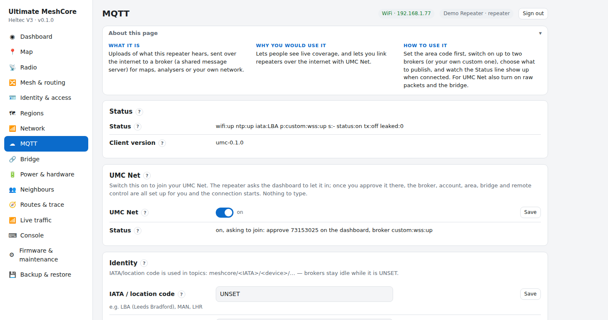
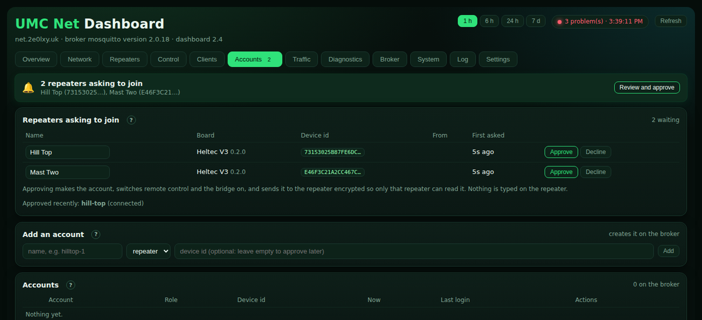

# UMC Net: zero-touch enrolment

A repeater joins your UMC Net with **one switch**. Nothing is typed: you switch *UMC Net* on in the repeater's MQTT page (or
`set mqtt.umcnet on`), the dashboard shows a notification, and when you press **Approve** the repeater is given its own account,
remote control and the bridge, and connects.

## What you do

1. On the repeater: MQTT page, **UMC Net**, switch on (console: `set mqtt.umcnet on`). It needs WiFi and the internet only.
2. On the dashboard: a bell bar *"1 repeater asking to join"* appears on every page and the **Accounts** tab shows a count. Open
   **Accounts**, check the name and device id, edit the name if you like, and press **Approve** (or **Decline**).
3. The repeater connects within a minute. `get mqtt.umcnet` reads `on, joined as <account>, area LBA, broker custom:wss:up, bridge on, control on`.

| 1. On the repeater: switch UMC Net on | 2. On the dashboard: approve it |
|---|---|
|  |  |

A repeater that was joined by a join code or by typing the settings is unaffected. The old manual settings and the join code
remain on the repeater's page under **Advanced**. **Remove** (Accounts tab) takes a repeater off the network at any time. A repeater
you **Decline** is ignored until you press **Forget**. Requests can be switched off in **Settings**.

## Phone apps and other internet clients

A client (the phone app) enrols the same way. It makes its own Ed25519 identity; the public key (64 capital hex digits) is its
**client id**. It publishes the same signed `hello` as the public `enrol` account and reads `umcnet/v1/enrol/grant/<ID>`.
On the dashboard's Accounts tab press **Approve as client** (instead of **Approve as repeater**). That makes a `client` account bound
to the id (it may write only `meshcore/+/<ID>/raw`, `meshcore/+/<ID>/status` and `umcnet/v1/+/replay/req/<ID>`, and read as a viewer does; no remote-control key, no bridge
settings) and the grant carries a setup code in place of a join code:

`umcclient1:` + base64url (no padding) of compact JSON `{"h":"<host>","u":"<account>","p":"<password>","i":"<client id>","a":"<area>"}`

The app connects with MQTT over WebSocket to `wss://<host>/mqtt`. The `hello` format is the same as for repeaters.

## How it works

```
repeater                         broker (public `enrol` account)                  dashboard (controller account)
   | CONNECT as enrol ---------------> |                                                  |
   | PUBLISH umcnet/v1/enrol/hello --> | ----------------------------------------------> | verify the signature, list it
   |   {id, name, fw, board, ts, nonce, sig}                                              | (you press Approve)
   |                                   | <---- RETAINED umcnet/v1/enrol/grant/<ID> ------ | make the account, encrypt the join code
   | <---------------------------------|                                                  |
   | open it, apply it like a join code, reconnect as its own account                     | clear the retained grant once it has joined
```

* **Request** (`hello`): JSON signed with the repeater's own Ed25519 identity key over `UMC-ENROL1|<ID>|<ts>|<nonce>`. The id *is*
  the public key, so a request is accepted only from the holder of that key; the time must be within a day.
* **Grant**: a normal join code (see `server/umcnet/README.md`) encrypted to the repeater's key. The server makes a one-time X25519
  key, the repeater's identity key gives the shared secret (`ed25519_key_exchange`), a key is derived with HMAC-SHA-256, and the
  text is XORed with an HMAC-SHA-256 keystream and authenticated with a 16-byte HMAC tag. Only the repeater whose key it was made for
  can open it, so it can sit on the broker as a retained message.
* **The `enrol` account** can only publish `umcnet/v1/enrol/hello` and read `umcnet/v1/enrol/grant/#`. Its password is public (it is
  in the firmware; override at install time with `ENROL_PASSWORD`): it opens only the doorbell.
* The dashboard's `controller` account reads `hello` and writes `grant/#`. Format and crypto: `src/helpers/mqtt/Enrol.h` and
  `server/umcnet/dash/umcnet_enrol.py`, tested against each other with the same vector (`test/test_enrol`, `test_dash.py`), and the
  whole flow against a real broker in `server/umcnet/dash/e2e_enrol.py`.

## Catch-up for clients

A client that was offline can ask the dashboard for the last hour of channel messages (dashboard 2.28 or later; run `umcnet-user sync`
or re-run `install-dash.sh` so the access lists gain the new topics).

* The dashboard keeps every group packet its repeaters hear or send for an hour, whether or not it holds the channel key.
* On connecting, the client publishes `{"since": <unix seconds>}` to `umcnet/v1/<area>/replay/req/<ID>` (`<ID>` is its 64 capital hex digit client id). `since` is never taken as older than one hour ago.
* The dashboard answers on `umcnet/v1/<area>/replay/<ID>`: up to 500 packets, oldest first, each `{"origin_id","timestamp","type":"RAW","data":"<hex>","direction":"rx|tx","snr","rssi","replay":1}`, then `{"done":1,"n":<count>}`. Not retained.
* One request per client id every 20 seconds; extra requests are ignored. A client may write only its own request topic and read only its own replay topic. Replays are never sent on `meshcore/.../raw`, so no repeater re-transmits them.

## Safety

| Risk | Answer |
|---|---|
| A stranger knocks | It appears in the list; nothing happens until you approve. At most 50 wait; they expire after a day; you can switch requests off. |
| Someone claims another repeater's id | The request must be signed by that id's key, so it is refused. |
| Someone reads a grant | It is encrypted to one repeater's key and removed from the broker once that repeater joins (or after a week). |
| The public password is abused | The account can send one kind of message and read encrypted ones; the broker's own limits apply. |
| A repeater is stolen or retired | Remove its account on the dashboard; it can no longer connect. |
| Replay of an old request | It only lists the same id again; the signature has a time and nonce. |

## Installing

Re-run `server/umcnet/dash/install-dash.sh`. It adds the `enrol` account, the new permissions for the controller account and the
`umcnet_enrol.py` module. Firmware 0.1.27 or later on the repeater.
