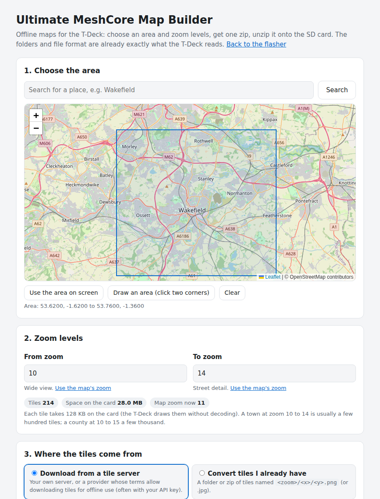

# Offline maps for the T-Deck

The T-Deck's **Map** page draws map tiles from the SD card, with your position and every contact that shares a location. It needs no
internet: the tiles are made once on a computer and copied to the card.



## The quick way: the map builder (in your browser)

Open **<https://2e0lxy.github.io/ultimate-meshcore/maps.html>** (also linked from the web flasher).

1. **Choose the area.** Search for a place, then press **Use the area on screen**, or **Draw an area** and click two opposite corners.
2. **Zoom levels.** *From* is the widest view, *To* the most detail. **Use the map's zoom** copies the map's current zoom. The page shows
   how many tiles that is and how much space they take on the card.
3. **Where the tiles come from.** Either:
   * **Download from a tile server**: paste the tile address of your own server, or of a provider whose terms allow downloading tiles
     for offline use (often with your own API key), for example `https://tiles.example.com/{z}/{x}/{y}.png?key=YOUR_KEY`. Tick the box
     to confirm the terms allow it. The server must let web pages read its tiles (CORS); most commercial tile services do.
   * **Convert tiles I already have**: choose a folder or a zip of tiles named `<zoom>/<x>/<y>.png` (or `.jpg`). Only the tiles inside
     the area and zoom levels are used; with no area chosen, all of them are converted.
4. **Build**, then **Download the zip**.
5. **Unzip it onto the top level of the SD card** (FAT32). The card must end up like this:

   ```
   SD card
   └─ maps
      ├─ 10
      │  └─ 507
      │     └─ 330.bin
      ├─ 11
      └─ …
   ```

   Not `maps/maps/…`, and not `umc-maps-…/maps/…`: if your unzip tool makes an extra folder with the zip's name, move `maps` up to the top.
6. Put the card in the T-Deck and restart it (or open **Map**). **Info → Maps** shows `SD maps, zoom 10-14` when it has found them.

To add another area later, unzip its zip onto the same card: the folders merge. The text file in the zip (`UMC-MAPS-README.txt`) can
stay on the card or be deleted; the T-Deck ignores it.

### How big?

Each tile is 128 KB on the card, because the T-Deck draws it straight to the screen without decoding an image. Every zoom level has
about four times the tiles of the one before:

| Area | Zoom | Tiles (about) | On the card |
|---|---|---|---|
| A town | 10 to 14 | 100 to 400 | 13 to 50 MB |
| A county | 10 to 14 | 1,000 to 3,000 | 130 to 400 MB |
| A county | 10 to 15 | 4,000 to 12,000 | 0.5 to 1.5 GB |

The builder makes up to 20,000 tiles at once (the zip is built in the browser's memory); for more, build in parts.

### Which tile sources?

OpenStreetMap's own tile servers are run by volunteers, and their
[tile usage policy](https://operations.osmfoundation.org/policies/tiles/) does not allow downloading areas for offline use; a client
that tries is sent an "Access blocked" picture instead of the map. The builder therefore refuses them, and other sources whose terms
forbid it (OpenTopoMap's servers, Esri and Google imagery). The map you scroll on the page uses OpenStreetMap only for viewing, which the
policy allows. Use instead:

* a tile provider whose plan allows offline use or caching (check their terms; many give a free key for personal use),
* your own tile server (for example one built from an OpenStreetMap extract), or
* tiles you already have on disk.

If a server sends the same picture for many different tiles (an error page, or "access blocked"), the builder stops rather than fill
your card with copies of it. Keep the attribution your source asks for; OpenStreetMap data is © OpenStreetMap contributors (ODbL).

## The other way: Python

`scripts/umc_make_map_tiles.py` does the same on a computer and writes straight to the card:

```bash
pip install pillow
python scripts/umc_make_map_tiles.py --bbox 53.5,-2.0,54.0,-1.2 --zoom 10-13 --url "https://tiles.example.com/{z}/{x}/{y}.png?key=YOUR_KEY" --out E:/maps
python scripts/umc_make_map_tiles.py --from-dir ./tiles --out E:/maps        # tiles you already have
```

Both tools produce exactly the same files.

## The tile format (for developers)

`/maps/<zoom>/<x>/<y>.bin`: standard web-mercator (slippy-map) tile numbers; each file is a 256 x 256 tile as raw RGB565,
big-endian, exactly 131,072 bytes, row by row from the top left. A file of any other size is ignored. The T-Deck caches the tiles it
shows in PSRAM, so panning stays smooth. See `examples/companion_radio/ui-tdeck/UmcTiles.h`.

## When the T-Deck shows no map

**Info → Maps** says what it found:

| Maps line | What it means |
|---|---|
| `SD maps, zoom 10-14` | Tiles found and in use |
| `no SD card` | The card wasn't readable: reseat it, or try another card (FAT32) |
| `card has no /maps folder` | The `maps` folder must be at the top of the card |
| `no tiles - /maps has 0 files, 1 folders` | Usually one folder too deep (`maps/maps/…` or `maps/tiles/…`): move the numbered folders up into `maps` |
| `no tiles - /maps has N files, …` | Image files (`.png`, `.jpg`) are not read: build the tiles with the map builder, which converts them |
