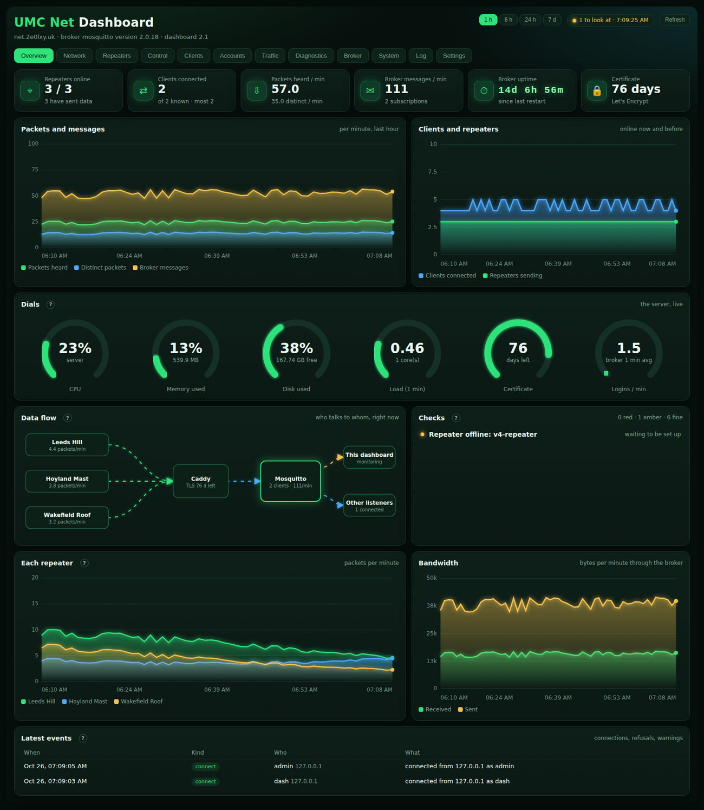
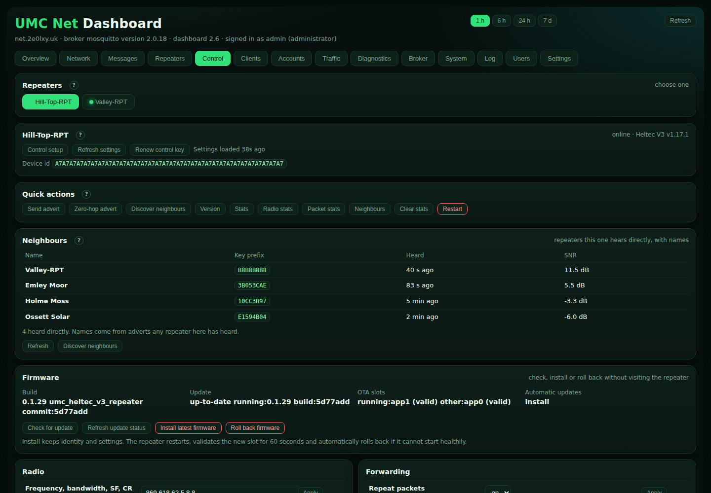
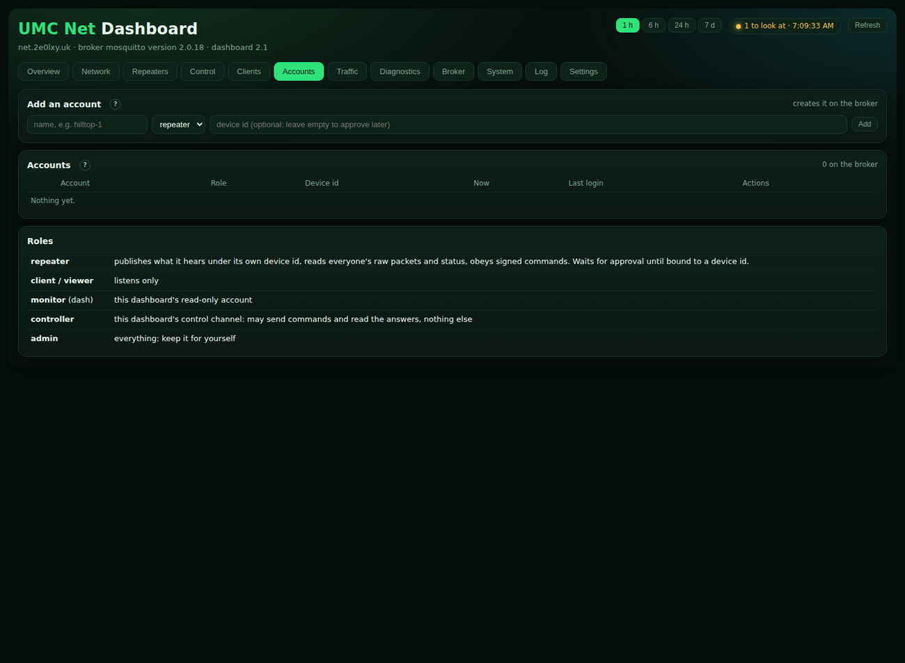
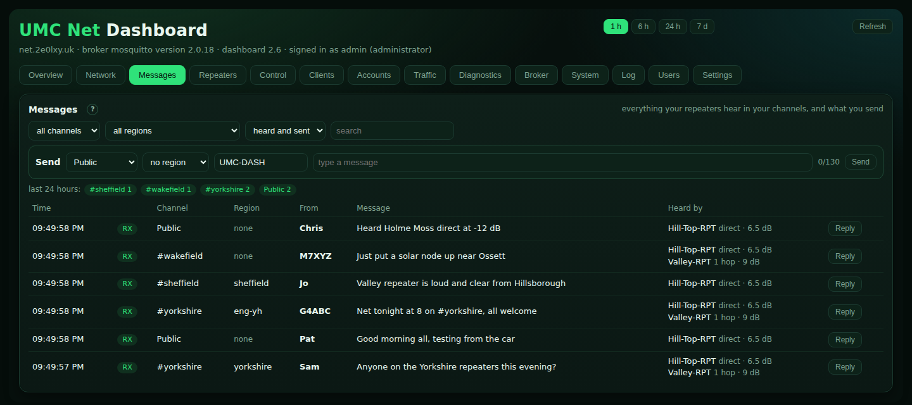
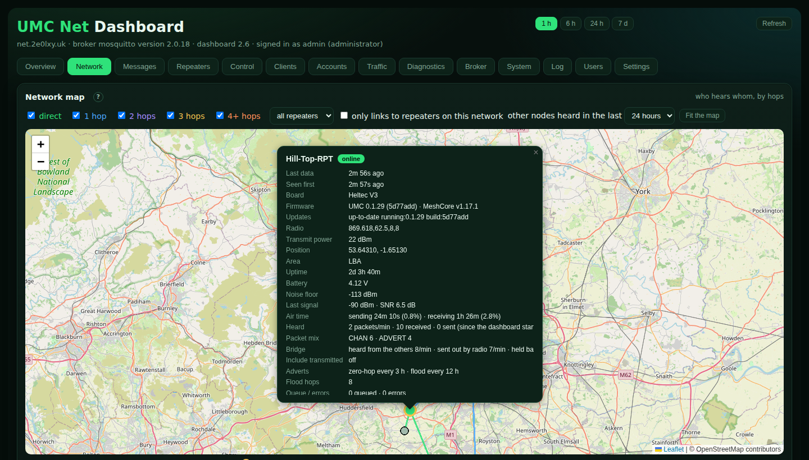
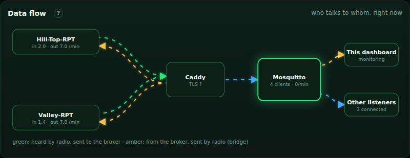
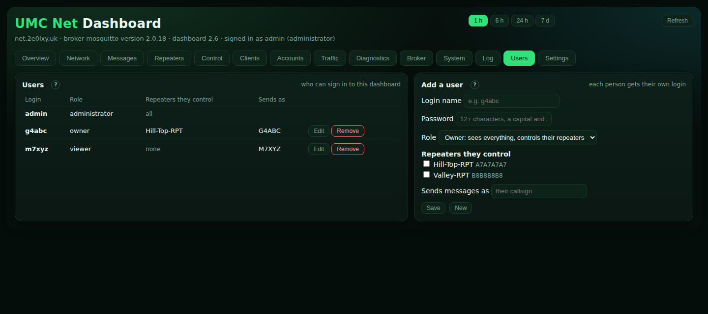
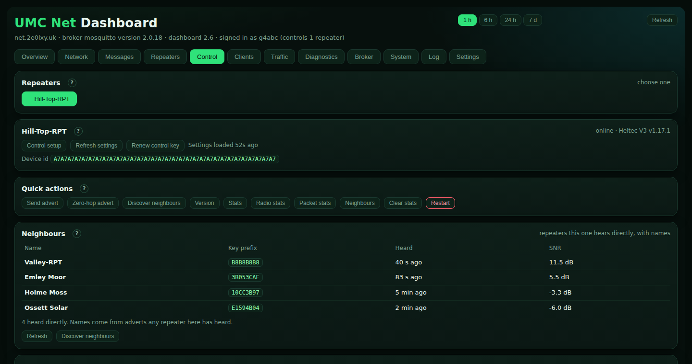

# UMC Net

A small MQTT network that joins Ultimate MeshCore repeaters and clients over the internet.
It is its own Mosquitto instance (own user, folders and systemd service), so it shares nothing
with the other services on the server. Caddy provides TLS in front of it.

```
repeater ──wss──► Caddy (443, TLS) ──► Mosquitto (127.0.0.1:9101) ◄──wss── repeater / client
```

Nodes connect to `wss://net.2e0lxy.uk/mqtt` with their own username and password. The firmware's
custom-broker mode already speaks this (`mqtt.custom.transport wss`).

## Topics

The standard MeshCore MQTT layout, which the firmware's uplink already publishes, so analysers
and maps can read this broker as well:

| Topic | Who writes | Who reads | Meaning |
|---|---|---|---|
| `meshcore/<area>/<device id>/raw` | that repeater | repeaters, clients | a packet it heard: `{"origin":..,"origin_id":..,"timestamp":..,"type":"RAW","data":"<hex>"}` |
| `meshcore/<area>/<device id>/packets` | that repeater | clients | the same packet, decoded |
| `meshcore/<area>/<device id>/status` | that repeater (retained, with a last-will) | everyone | online or offline, version, radio |

`<area>` is the code set with `set mqtt.iata` (for example `LBA`), `<device id>` the repeater's
64-digit public key in capitals. Create a repeater's account with
`umcnet-user add <name> repeater --device <id>` and it can write only under its own id.

## How the bridge works

On a repeater, `set mqtt.custom.bridge on` makes the MQTT uplink also subscribe to
`meshcore/<area>/+/raw`. Each packet another repeater published is passed to the mesh as if it had
arrived by radio, after the bridge delay. The mesh drops what it has already seen, so nothing
loops, and forwards the rest by its normal rules (hop limit, regions, duty cycle). At most
`mqtt.custom.rate` packets a minute are passed on (default 20). Our own packets are skipped.

## Roles

`admin` everything · `repeater` writes only under its own device id, reads everyone's raw packets
and status · `client` and `viewer` read only.

## Install

```
curl -fsSL https://raw.githubusercontent.com/2E0LXY/ultimate-meshcore/main/server/umcnet/install.sh | sudo bash
umcnet-user add <name> <admin|repeater|client|viewer>     # prints the password
# once the DNS record for net.2e0lxy.uk points at this server:
curl -fsSL https://raw.githubusercontent.com/2E0LXY/ultimate-meshcore/main/server/umcnet/enable-caddy.sh | sudo bash
```

Passwords for the first accounts are written to `/root/umcnet-credentials.txt` (mode 600) and are
never stored in the repository.

## Duty cycle

Re-sending traffic from the network over 869 MHz counts against the repeater's duty cycle. The
bridge is off by default, and a repeater drops network packets rather than exceed its limit.


## The dashboard (admin page)



The broker itself has no web admin. Accounts are managed with `umcnet-user` on the server, and everything else
you can see is in the **dashboard**: `https://net.<your domain>/`, behind a login (user `admin`; the password is
printed by the installer and kept in `/root/umcnet-credentials.txt`).

```
curl -fsSL https://raw.githubusercontent.com/2E0LXY/ultimate-meshcore/main/server/umcnet/dash/install-dash.sh | sudo bash
```

It runs as its own unprivileged service on `127.0.0.1:9102` (Python standard library only), listens to the broker
with a read-only `monitor` account, tails the broker's log, samples the machine, and keeps 14 days of history in
SQLite under `/var/lib/umcnet-dash`. About 20 MB of memory.

| Tab | What it shows |
|---|---|
| Overview | Repeaters and clients online, packets and messages a minute, dials for CPU, memory, disk, load, certificate and logins, a live data-flow diagram, the checks, charts per repeater and bandwidth, the latest events |
| Network | A map of every node the repeaters hear, with a line for each link coloured by hops (green direct, blue 1 hop, purple 2, amber 3, orange 4+), filters, a table of links and the journey of each packet |
| Repeaters | One card per repeater: device id, model, firmware, radio, battery, uptime, noise floor, airtime, counters, clock, packet types; which repeaters hear the same packets and how many hear each |
| Control | Preloaded settings for every online repeater, complete signed CLI, quick actions, firmware check/install/rollback, labels and the redacted audit trail |
| Clients | Everything connected to the broker: account, address, since when, keepalive, protocol, logins in the last hour |
| Accounts | Every account with its role, bound device id, whether it is online, last login and last data |
| Traffic | Live packets with the sender (an advert's name, or a hash matched to a known repeater) and the repeater that passed it on; packet types; delivery delay |
| Diagnostics | All checks, refused logins by address, the event history (14 days) |
| Broker | The broker's own statistics: every `$SYS` value, load averages, history |
| System | CPU, memory, disk, network, services, the TLS certificate, the dashboard's own footprint |
| Log | The broker's log, filterable |

The checks cover: the dashboard's link to the broker, each service, broker restarts, the certificate (amber under 14
days, red under 5), disk, memory, load, refused logins and where they came from, clients that reconnect too often, a
repeater account that is not bound to a device id, repeaters that are offline or silent, a repeater whose clock is
wrong, and messages the broker drops.

Limits: a publish that the access list silently drops is not logged by Mosquitto, so it cannot be shown. The
history starts when the dashboard is installed.


## Controlling repeaters, approvals and settings (dashboard 2.3)

| Control | Accounts and approvals |
|---|---|
|  |  |

**Control tab.** Pick a repeater: its settings and firmware state are preloaded automatically. Press *Refresh settings*
only when you need a new copy, change a value and press *Apply*, or use a quick action, the firmware panel or the
complete device console. Every command is checked, signed and recorded in the audit log; commands that change the
device ask you to confirm first, and commands or replies containing secrets are redacted from the audit trail.

How it is kept safe:

| Layer | What it does |
|---|---|
| Off by default | The repeater obeys nothing until you set a control key and `set mqtt.control on`. |
| Signature | Each command carries an HMAC-SHA-256 over device id, time, a counter and the command, made with a key only the dashboard and that repeater hold. A wrong signature gets no answer, so it cannot be used to test guesses. |
| Freshness | The time must be within 5 minutes, later than the repeater's last restart, and the counter must be higher than the last one used: a recorded command cannot be replayed. |
| Full administrator CLI | A valid signed administrator may use every well-formed device command, including WiFi, broker and firmware maintenance. Structural checks still reject oversized, multiline, quoted or malformed transport input. |
| Rate limit | 60 commands a minute (enough to read every setting in one go). |
| Broker accounts | The `controller` account may only publish to `umcnet/v1/<area>/dev/<id>/cmd` and read `.../resp`. A repeater may read only its own command topic and write only its own answers. |
| Confirmation and redaction | Changing commands require confirmation; secret commands and replies are replaced with redacted markers in the persisted audit log. |

To put a repeater under control: *Control setup* on its card shows a block of commands (broker address, its account and
the control key). Paste it into the repeater's Console page; the dashboard then loads its settings automatically.

**Firmware panel.** *Check for update* asks the repeater to query the release manifest, *Install latest firmware* starts
the normal verified OTA update and *Roll back firmware* selects the previous slot. The panel shows the current build,
update status, automatic-update policy and both OTA slots. Identity and settings are retained, and the firmware's normal
60-second validation and automatic rollback still apply.

**Public viewer.** `https://net.<domain>/public/` is a no-login, read-only view of repeater status, network links and
recent mesh traffic. Caddy exposes only `/public` and `/public/api/*` without authentication. Those endpoints have no
POST routes and exclude accounts, client addresses, keys, configuration, logs, private owner information and locations
learned through private control commands. The administrator dashboard at `/` remains behind its login.

**Approving new repeaters.** *Add an account* on the Accounts tab creates a repeater account with no device id. It is
*pending*: it can connect and listen to statuses, but it cannot publish or be controlled. When the repeater connects, the
dashboard shows the account, the address it came from and the first characters of its device id; you paste its full
64-character id (under Identity, or on its display) and press *Approve*. The id must match the one that connected. Until
then nothing it sends is accepted. *Block* shuts an account out immediately; *New password* and *Remove* are there too.

**Settings tab.** Limits for each check, how long history is kept, whether risky commands need confirming, alerts to a
web address or an ntfy topic (silent repeater, back again, waiting for approval, many refused logins, certificate,
disk), the dashboard password, downloads (events, audit log, repeaters as CSV; settings as JSON) and service restarts.

**Privilege.** The dashboard runs unprivileged. Account changes, the dashboard password and service restarts go through
`umcnet_admin.py`, a small root helper on a Unix socket that only the dashboard's user can open; it accepts a fixed list
of operations and checks every argument.


### Joining with one line (dashboard 2.2, firmware 0.1.21)

Add a repeater on the **Accounts** tab (or press **Join code** on its row) and the dashboard shows one line:

```
set mqtt.join UMC1.AQBHQlILdWktdGVzdC1vbmUT...
```

Paste it into the repeater's Console (or the *Join code* box on its MQTT page). The repeater applies the broker (built into the
firmware, or carried in the code), the account and password, the area code, raw packets on, transmitted off, the bridge as set in
the dashboard's Settings, and the remote-control key when the repeater has been approved, then connects. `set mqtt.umcnet off|on`
switches the link, and `get mqtt.umcnet` reports `on, joined as <account>, area LBA, broker custom:wss:up, bridge on, control on`.

The code is `UMC1.` plus base64url of: version, flags (control key, bridge, own host), the three-character area, the account and
password, optionally a host and port, optionally the 32-byte control key, and a 3-byte SHA-256 check, so a mistyped or cut-off code
is refused rather than half applied. It contains the repeater's password: treat it like one. A new code gives the account a new
password. The format is in `src/helpers/mqtt/JoinCode.h` and `make_join_code` in `umcnet_dash.py`, tested against each other.

### Alerts to your phone with ntfy (dashboard 2.3.1)

`server/umcnet/dash/install-ntfy.sh` installs a private [ntfy](https://ntfy.sh) server on the same machine: it is served by Caddy on
`https://<your host>:8443` (the certificate you already have; no extra DNS record), everything is denied by default, and there are two
logins on one secret topic: one for your phone (read and send) and one for the dashboard (send only). The script prints the phone
settings and the dashboard address. In the dashboard open **Settings → Alerts**, tick *enabled* and paste the address
`https://umc-dash:<password>@<host>:8443/<topic>`: the dashboard sends it with that login. It alerts when a repeater has been silent
for too long (and when it is back), when an account is waiting for approval, on refused logins, when the certificate is close to
expiry, when the disk is nearly full and when the control link is down. Open port 8443 in any firewall in front of the server.
Alerts cannot reach you if the whole server is down, so keep an outside check for that.

### Checking that remote control works (`check_remote.py`)

```
UMC_DASH_PASS=... python3 server/umcnet/dash/check_remote.py https://net.example.org admin [--reboot] [--reboot-only] [--ui]
```

For every repeater the dashboard knows it reads each setting the Control tab shows, runs the quick actions, writes each editable
setting back with its own value (nothing changes), checks the confirmation and refusal rules, reads all settings in one batch and asks
for a firmware check. `--reboot` also restarts each repeater and checks it returns with its settings; `--ui` opens the Control tab in a
browser and checks that no drop-down or box is blank. It does not rewrite latitude and longitude (the repeater keeps them with limited
precision). Exit status 0 means everything passed.

### Messages, map and data flow (dashboard 2.5)



| Map (click a repeater for its details) | Data flow, both ways |
|---|---|
|  |  |

* **Messages tab.** Each repeater publishes every packet it hears; a group (channel) message is encrypted with its channel's key, so the dashboard reads the channels listed in Settings (a `#hashtag` channel needs only its name; any other needs its key). A message sent into a region carries a code only that region's name produces, so the dashboard names the region by trying the regions in Settings. Filter by channel, region, direction or text. **Send** builds the same packet a radio would and publishes it on `meshcore/<area>/<dashboard id>/raw`; every repeater with the bridge on transmits it (region-scoped if you chose one). Limits: 130 characters, 6 a minute, a confirmation before sending. Messages in channels without a key are only counted. Kept for 30 days (Settings). Needs the controller account's new permission: re-run `install-dash.sh`.
* **Map.** A repeater that is connected and online is a green dot with a yellow edge; one that is not on the network is not drawn. Other nodes appear if heard within the chosen time (1 hour to 30 days). Click any node for its details: for your repeaters board, firmware, uptime, battery, noise floor, airtime, packet mix, bridge traffic, settings and who it hears.
* **Data flow.** Arrows both ways: what each repeater hears and publishes, and what the broker hands back for its radio to send (the bridge), measured once a minute with `get mqtt.custom.bridge`.
* **Control tab.** Neighbours (with names from any repeater's adverts) are read when the tab opens and each minute; settings are re-read if older than ten minutes.
* `e2e_messages.py [--ui]` tests all of this against a real broker.

### Logins for each person (dashboard 2.6)

| The administrator's Users tab | What an owner sees |
|---|---|
|  |  |

Every person gets their own login (**Users** tab, administrator only). Caddy checks the password (several logins in the
`basic_auth` block of `umcnet.caddy`) and tells the dashboard who signed in (`X-UMC-User`; the public pages never carry it).

| Role | Sees | Can do |
|---|---|---|
| Administrator (`admin`, or a user given that role) | everything | everything: settings, accounts, users, every repeater |
| Owner | the whole network, every message, every repeater's data | control, update and restart **only the repeaters ticked for them**; send and reply to messages, under their own name |
| Viewer | the whole network and every message | nothing |

A user changes their own password on their Settings tab. Secrets (the alert address with its password, the user list, exports)
are only given to the administrator. Re-running `install-dash.sh` keeps every login. The root helper adds, resets and removes logins
(`web_user_set`, `web_user_remove`) and rolls the Caddy file back if Caddy refuses it.

**Messages** refresh every five seconds while the tab is open; new ones are highlighted and counted on the tab when you are
elsewhere. **Reply** fills in the channel, the region and `@[sender]`. Room servers' messages are encrypted for their members
only, so they cannot be shown. On the map a station that was reflashed or replaced (new key, same name) is shown once, newest first.

### Screenshots

`server/umcnet/dash/shots_dashboard.py <folder>` takes the dashboard pictures used in the README and manual from a real broker and
dashboard fed by simulated repeaters with demo names; `web/umc/shots_web.py <folder>` takes the repeater and client page pictures
from their built-in demo mode, and the web flasher.

### One clock for the whole network (`install-time.sh`)

Signed remote commands are accepted only within a minute of the repeater's clock, so the repeaters should keep the same time as
the server. `install-time.sh` makes the server a time server (chrony, UDP 123, rate-limited) that keeps itself right from the public
pool. Point each repeater at it with `set ntp.server1 <server name>` (the dashboard can do it from the Control tab); the public
servers stay as servers 2 and 3 in case it cannot be reached. From firmware 0.1.31 the repeaters re-sync every hour. The dashboard's
Diagnostics flag any repeater whose clock is off.

### Time: the server keeps the network's clock (install-ntp.sh, dashboard 2.7)

`server/umcnet/install-ntp.sh` sets up **chrony** on the server, synchronised to the UK's **National Physical Laboratory**
(`ntp1.npl.co.uk`, `ntp2.npl.co.uk`, traceable to UTC(NPL)), with the UK NTP pool as a fallback only if both are unreachable, and
answers time requests on UDP 123 (rate-limited). Point each repeater at it, with NPL as its own fallbacks:

```
set ntp.server1 net.2e0lxy.uk
set ntp.server2 ntp1.npl.co.uk
set ntp.server3 ntp2.npl.co.uk
```

From firmware 0.1.31 the repeaters re-sync every hour. The dashboard's System tab shows the server clock (source, stratum, offset),
the Diagnostics tab warns if it is not synchronised, and each repeater's clock difference from the server is shown on its card.
Signed remote commands are accepted only within a minute of the right time, so a good clock is what keeps remote control working.

### Decoded copies for other apps (dashboard 2.8)

Repeaters keep bridging the real radio packets both ways, and everything is shown and answered on the dashboard's **Messages** tab.
In addition, the dashboard publishes read-only JSON copies of what it decodes, so Home Assistant, Node-RED and similar can use them
without decoding MeshCore packets themselves (Settings: *Also publish decoded messages…*, on by default):

| Topic | When | Example |
|---|---|---|
| `umcnet/v1/<area>/messages` | each channel message heard, or sent from the dashboard | `{"id":12,"time":1793612345,"channel":"#yorkshire","region":"yorkshire","sender":"Sam","text":"anyone on?","dir":"rx","heard_by":[{"name":"TINGLEY-REPEATER","hops":0,"snr":6.5,"rssi":-92}]}` |
| `umcnet/v1/<area>/adverts` | each node's advert (at most every ten minutes per node, or when it changes) | `{"key":"52906E2B…","name":"Grange Moor Solar","type":"repeater","lat":53.64,"lon":-1.74,"time":1793612345,"heard_by":"TINGLEY-REPEATER","hops":1,"snr":-6.0}` |
| `umcnet/v1/<area>/nodes/<key>` | retained; online while heard within a day | `{"key":"52906E2B…","name":"Grange Moor Solar","type":"repeater","lat":53.64,"lon":-1.74,"last":1793612345,"online":true}` |

Messages are only published for channels the dashboard has a key for. Give an app its own read-only account (Accounts tab, role
**viewer**, or `umcnet-user add homeassistant viewer`): it can read these topics but cannot put anything on the network.
After updating, `install-dash.sh` runs `umcnet-user sync`, which rewrites every account's permissions for the new topics.
